<div align="center">

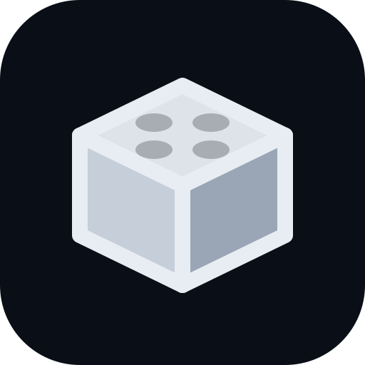

# TN Dashboard

**Alle Werkzeuge für den Lego-Shop in einer App:**
**Teile-Scanner, Inventar, Umlagern, Inventur, Aufträge und mehr, für Teilnehmer und Lehrer.**


[](https://github.com/jimrocko/TN-Dashboard/actions/workflows/build.yml)

<a href="https://raw.githack.com/jimrocko/TN-Dashboard/HEAD/TN-Dashboard-Demo.html"></a>
<a href="https://raw.githack.com/jimrocko/TN-Dashboard/HEAD/TN-Dashboard-Tutorial.html"></a>
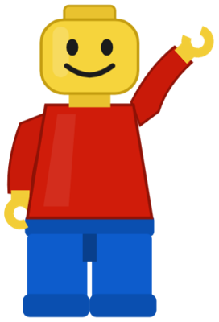

Anmelden mit `max` / `max12345` (Teilnehmer) oder `lehrer` / `lehrer123` (Lehrer).<br>
<sub>Die Demo ist die komplette App mit erfundenen Daten (rund 125.000 Teile in über 1.400 Kästchen). Alles bleibt nur in deinem Browser.<br>
Im **Tutorial** führt dich Klemmi, unser Maskottchen, durch die App. Zuerst wählst du **Lehrer** oder **Schüler**, dann tippst du alles selbst.</sub>

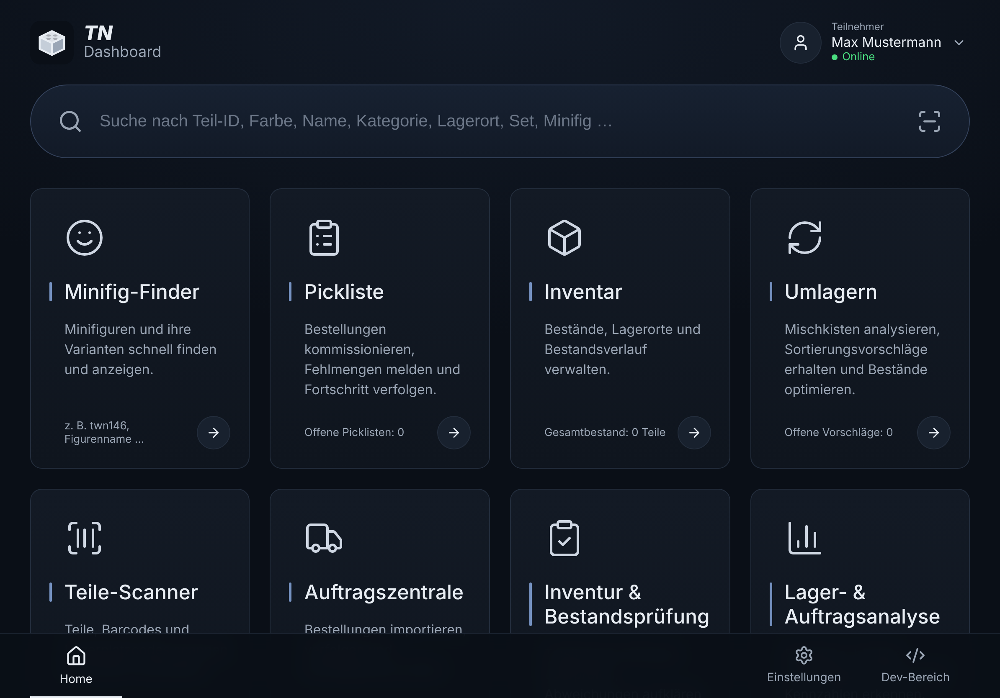

</div>

## Worum geht es?

Im Lego-Shop der Schule arbeiten die Teilnehmer mit BrickLink, BrickStore und vielen kleinen Werkzeugen. Das **TN Dashboard** bündelt das in einer App, die auf iPad, PC und Handy im Browser läuft und sich wie eine App auf den Home-Bildschirm legen lässt.

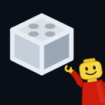

Auf dem Home-Bildschirm (Safari → Teilen → „Zum Home-Bildschirm“) erscheint das App-Icon: der Lego-Stein des TN Dashboards, unten rechts winkt Klemmi aus der Ecke. Das gilt für die App auf dem Schulserver genauso wie für Demo und Tutorial.
<br clear="left">

Jede Aktion wird pro Teilnehmer protokolliert. Der Lehrer sieht so jederzeit, wer was gemacht hat, und kann es als CSV exportieren.

## Die Bereiche

Alles ist anklickbar: Jeder Lagerort öffnet seine Lagerort-Seite, jede Teil-Nr. die Teile-Seite, jeder Auftrag die Auftragszentrale, Kategorien und Balken in der Analyse filtern das Inventar.

| Bereich | Was man dort macht |
|---|---|
| **Startseite** | Große Kacheln für alle Bereiche mit Live-Zahlen (Bestand, offene Aufträge, Vorschläge, offene Inventuren) und eine Suche über alles. |
| **Suche** | Eine Suche über Teil-Nummern, Namen, Farben, Kategorien, Lagerorte und Aufträge. |
| **Teile-Scanner** | Teil mit der Kamera fotografieren. Es wird automatisch erkannt (über den kostenlosen Dienst [Brickognize](https://brickognize.com)), danach öffnet sich direkt die Teile-Seite. |
| **Teile-Seite** | Alles zu einer Teil-Nr.: Bestand nach Farbe und Lagerort, Wert, in offenen Aufträgen reservierte Menge, Aufträge mit dem Teil, letzte Umlagerungen, Link zu BrickLink. Jede Teil-Nr. in der App führt hierher. |
| **Lagerort-Seite** | Was in einem Kästchen liegt: Inhalt mit Menge und Wert, Inventur-Stand, was woanders hingehört, welche offenen Aufträge hier Teile holen, letzte Umlagerungen. Mit Pfeilen zum Nachbarfach blättern. |
| **Inventar** | Alle Lots nach Nummer, Farbe, Kategorie und Lagerort filtern und sortieren, mit Menge und Wert. Über den Knopf **Lagerplan** lässt sich derselbe Raumplan wie in Umlagern aufklappen (ohne Mischkisten-Markierung), um Kästchen direkt anzutippen. |
| **Umlagern** | Zwei Arten von Vorschlägen, jeweils mit einem Tipp übernehmen: **Falsch einsortiert** (gleiches Teil in gleicher Farbe liegt in mehreren Kästchen → alles in das Kästchen mit der größten Menge) **Farben zusammenlegen** (gleiches Teil in anderen Farben → in ein Kästchen, das nur dieses Teil enthält) und **Gleiche Teile-Art** (z. B. Bricks zu Bricks, Plates zu Plates → in ein Kästchen, das nur diese Art enthält); höchstens 3 Lots pro Kästchen. Immer nur innerhalb eines Bereichs, gebraucht bleibt gebraucht. Dazu freies Umbuchen. Der **Lagerplan** zeigt das Lagerzimmer von oben, kompakt und ohne Farben, mit klar abgegrenzten Bereichen und den Regalen an den Wänden (Kästchen wie G245, H012, N005; G = gebraucht, H, N = neu, FG/FN/FT/Plate = Figuren und Plates). Ein Tipp auf einen Bereich zeigt die Hunderter-Blöcke, dann die einzelnen Kästchen; ein Tipp auf ein Kästchen öffnet seinen Inhalt. G-Kästchen mit mehr als 3 verschiedenen Lots sind **rot** markiert: Das sind Mischkisten, die noch aufgeteilt werden müssen. Direkt nach dem Umlagern öffnet sich das Fenster **Zu BrickLink übertragen**: Er kopiert den ganzen Bestand als BrickLink-XML (alle Lots mit der Menge nach dem Abziehen, Lagerort in den Remarks) in die Zwischenablage und öffnet BrickLink; dort unten beim Upload einfügen und bestätigen, danach in der App „Ja, ist eingefügt“. Es läuft immer nur eine Übertragung, die alle sehen und jeder abschließen kann. Buchen zwei gleichzeitig dasselbe Lot, geht nur die erste Buchung durch. |
| **Inventur & Bestandsprüfung** | Einen Lagerort zählen, Abweichungen erfassen und beim Abschluss den Bestand korrigieren. |
| **Auftragszentrale** | Bestellungen nach Status, Positionen sortiert nach Lagerort (Laufweg beim Picken), Status weiterschalten. |
| **Lager- & Auftragsanalyse** | Bestand nach Kategorie, volle Regalplätze, Mischkisten, Engpässe, Aufträge nach Status, Aktivität pro Teilnehmer. |
| **Minifig-Finder, Pickliste** | Die bestehenden Programme der Schule, im Dashboard mit gemeinsamem Login. |
| **Meine Aktivitäten** | Das eigene Protokoll. |
| **Einstellungen** | Hell/Dunkel, Dichte, Schriftgröße und Animationen, pro Gerät. |
| **Lehrer-Ansicht** | Teilnehmer anlegen und löschen (das Protokoll bleibt erhalten), Protokoll aller oder einzelner Teilnehmer, CSV-Export, Dev-Rolle vergeben. **Lager aus BrickLink übernehmen:** holt alle Lots aus dem BrickLink-Shop mit Lot-IDs und Lagerort (aus den Remarks), damit Umlagerungen per Knopf zurück zu BrickLink gehen. |
| **Dev-Bereich** | Werkzeuge für Entwickler, nur für Lehrer und Teilnehmer mit Dev-Rolle. Siehe unten. |

### Dev-Bereich

Der Dev-Bereich ist für alle gedacht, die an der App mitarbeiten. Zugang haben **Lehrer** und **Teilnehmer, denen ein Lehrer die Dev-Rolle gibt** (Lehrer-Ansicht, Spalte „Dev“). Alle anderen sehen den Knopf gar nicht, und jede Dev-Route prüft die Rolle am Server. Einen zusätzlichen Code gibt es nicht: Man ist ohnehin mit dem eigenen Passwort angemeldet.

| Reiter | Inhalt |
|---|---|
| **System** | App-Version und Modus, Datenbank (Treiber, Version, Größe), PHP mit Erweiterungen und Upload-Grenzen, Dienste (BrickLink, Teileerkennung, HTTPS), welche Einstellung aus welcher `.env`-Variable kommt (nur Namen, nie Werte), Infos zum eigenen Gerät (Bildschirm, Touch, Kamera, Speicher, Verbindung). |
| **Tests** | Selbsttests mit einem Tipp: Datenbank lesen und schreiben, Sitzung, Temp-Ordner, BrickLink, Teileerkennung, alle API-Endpunkte (nur lesend) und Gerätefunktionen wie Speicher, Kamera und Offline-Modus. |
| **Daten** | Alle Tabellen der App ansehen, blättern, filtern und als JSON kopieren. Nur lesen; Passwörter und gespeicherte Geheimnisse werden nie angezeigt. |
| **API** | API-Konsole für lesende Aufrufe, Liste der letzten Aufrufe mit Status und Dauer, BrickLink-Artikel abrufen. |
| **Einstellungen** | Debug-Anzeige, langsames Netz simulieren, API-Aufrufe mitschreiben, lokale Daten und App-Cache leeren, Demo-Daten zurücksetzen. |

## Screenshots

<table>
  <tr>
    <td width="50%">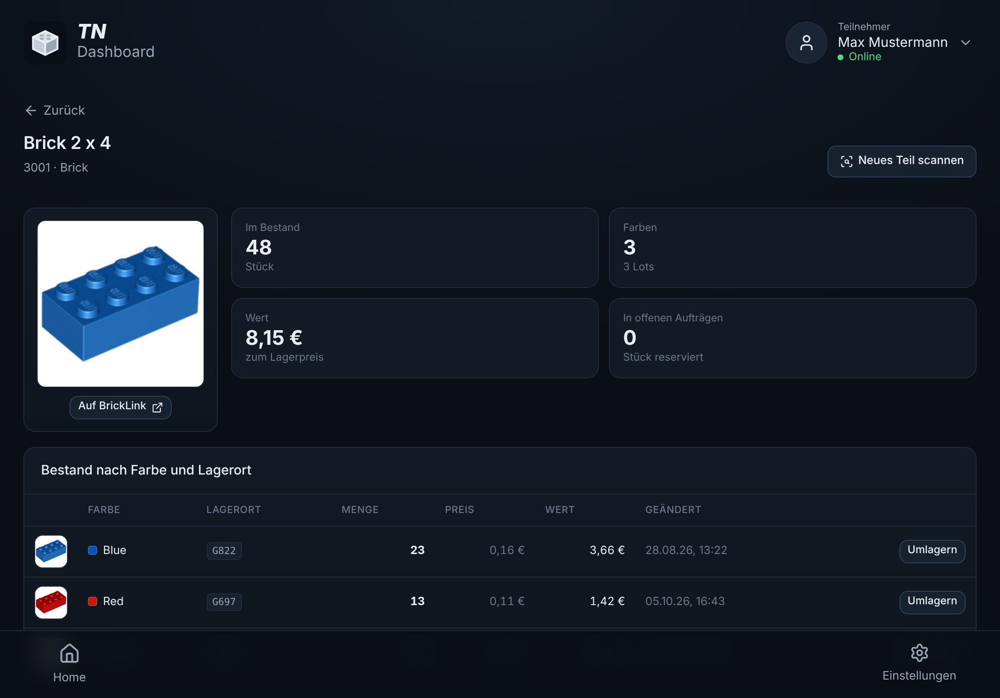<br><sub><b>Teile-Seite</b>: öffnet sich nach dem Scannen</sub></td>
    <td width="50%">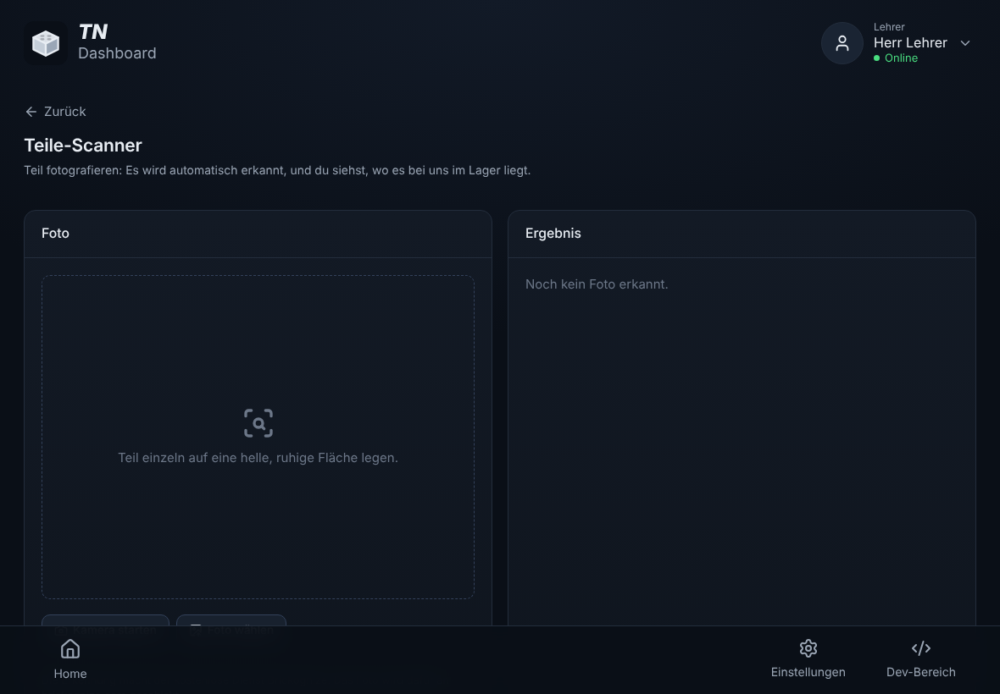<br><sub><b>Teile-Scanner</b>: Foto machen, Teil wird erkannt</sub></td>
  </tr>
  <tr>
    <td width="50%">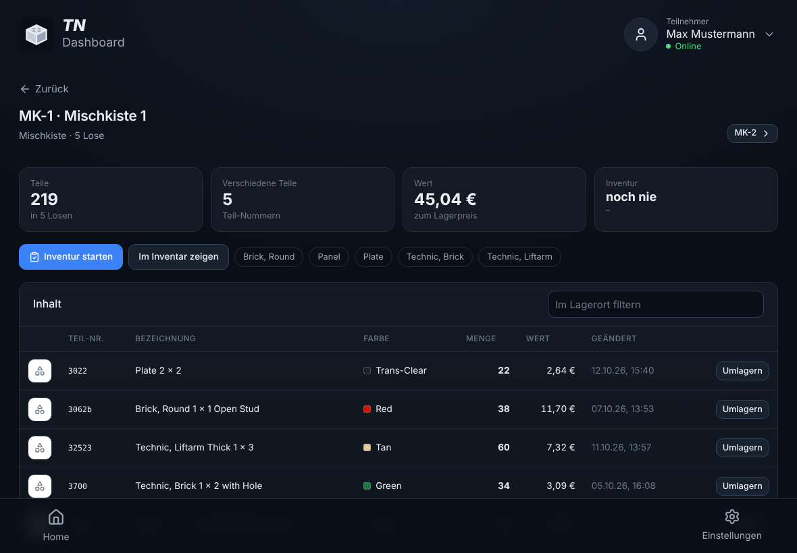<br><sub><b>Lagerort-Seite</b>: was liegt wo</sub></td>
    <td width="50%"><br><sub><b>Startseite</b>: alle Bereiche auf einen Blick</sub></td>
  </tr>
  <tr>
    <td width="50%">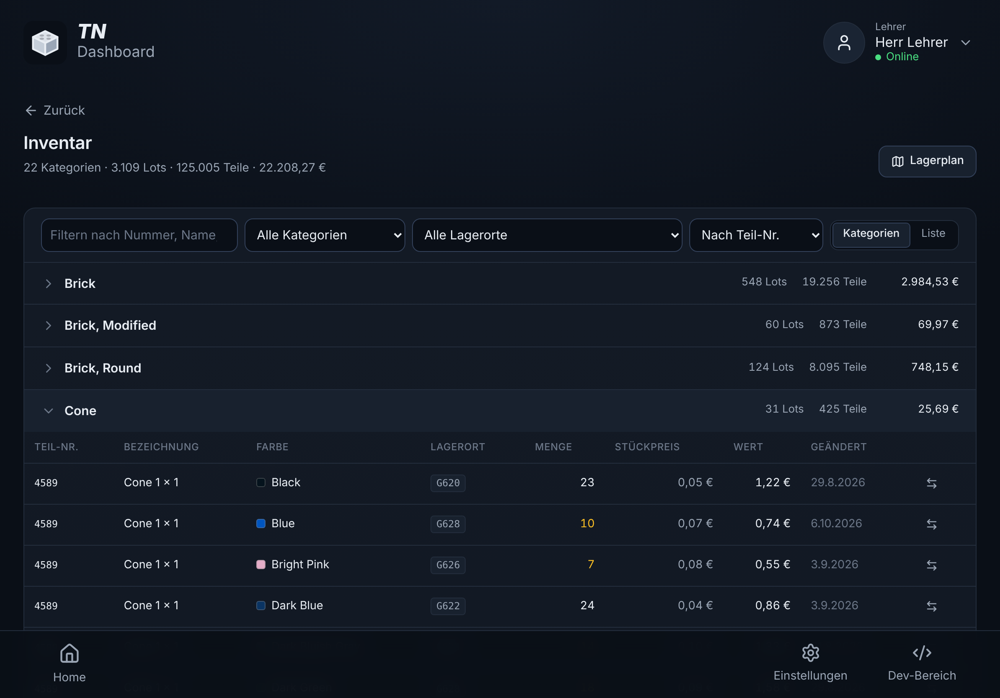<br><sub><b>Inventar</b>: filtern nach Kategorie, Lagerort und Text</sub></td>
    <td width="50%">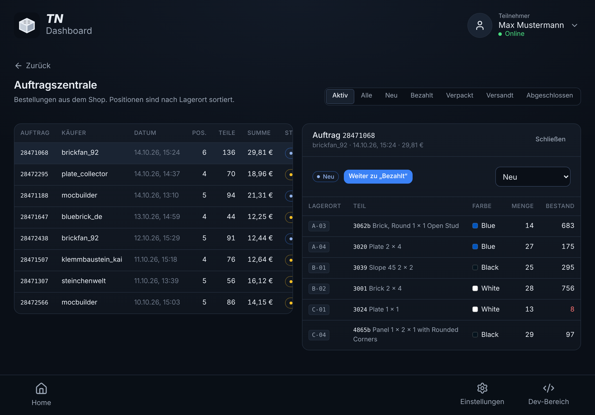<br><sub><b>Auftragszentrale</b>: Positionen nach Lagerort sortiert</sub></td>
  </tr>
  <tr>
    <td width="50%">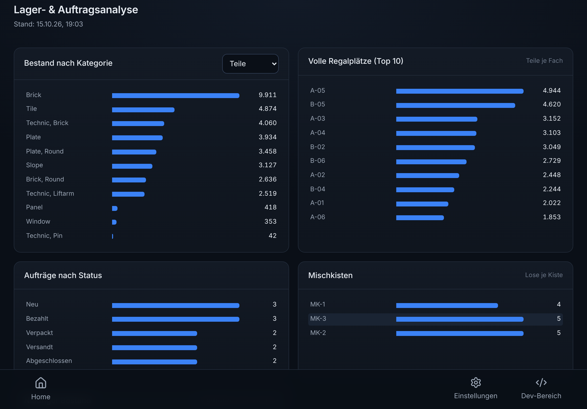<br><sub><b>Analyse</b>: Kennzahlen zu Lager und Aufträgen</sub></td>
    <td width="50%">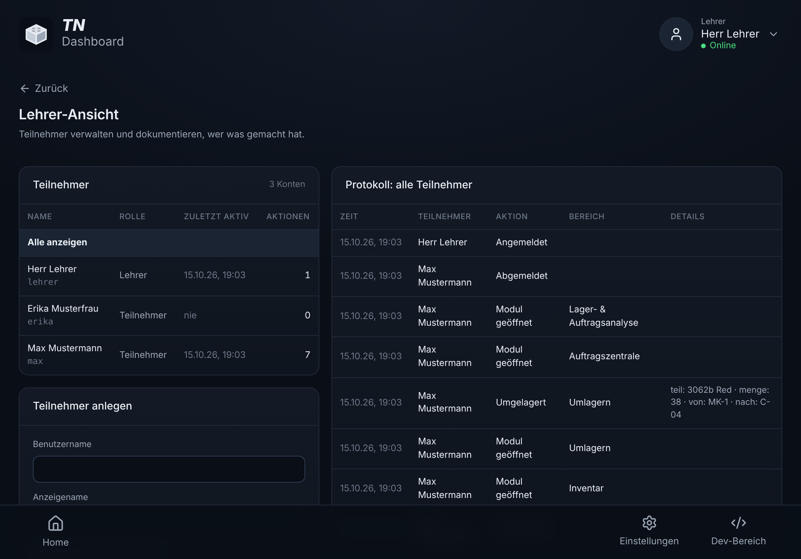<br><sub><b>Lehrer-Ansicht</b>: wer hat was gemacht</sub></td>
  </tr>
  <tr>
    <td width="50%">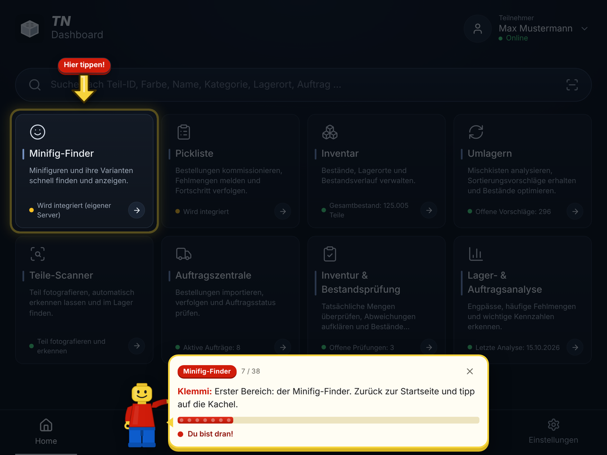<br><sub><b>Tutorial</b>: Klemmi zeigt, wohin du tippst</sub></td>
    <td width="50%">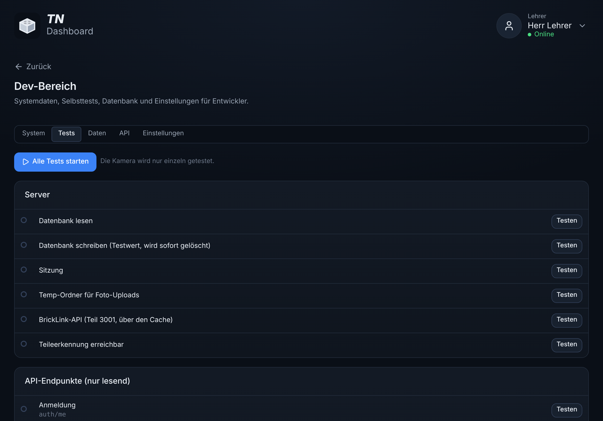<br><sub><b>Dev-Bereich</b>: Selbsttests</sub></td>
  </tr>
</table>

<p align="center">
  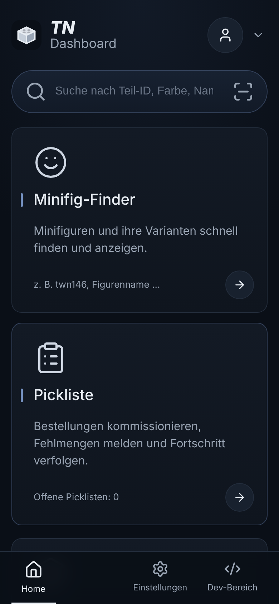<br>
  <sub><b>Auf dem Handy</b>: Das Layout passt sich jeder Bildschirmgröße an</sub>
</p>

## Rollen

| | Teilnehmer | Teilnehmer mit Dev-Rolle | Lehrer |
|---|:-:|:-:|:-:|
| Alle Shop-Bereiche | ✓ | ✓ | ✓ |
| Eigenes Protokoll | ✓ | ✓ | ✓ |
| Dev-Bereich | | ✓ | ✓ |
| Lehrer-Ansicht, Konten anlegen und löschen, Dev-Rolle vergeben | | | ✓ |

## So läuft es auf dem Schulserver

- **Frontend:** Vue 3 als installierbare Web-App (PWA). Auf dem Server liegen nur fertige Dateien, Node wird dort nicht gebraucht.
- **Backend:** PHP 8.1+ ohne Framework, läuft auf jedem normalen Webspace. Einstieg ist `api/index.php` (Routen über `?r=…`, keine Rewrite-Regeln nötig).
- **Datenbank:** die vorhandene MySQL/MariaDB der Schule. Alle Tabellen beginnen mit `tn_` und bleiben so getrennt vom Lehrer-Dashboard.
- **Zugangsdaten:** kommen aus der vorhandenen `.env` des Servers. Sie wird nur gelesen und nie verändert; eine `.htaccess` sperrt sie für den Zugriff über das Web.
- **BrickLink:** API-Antworten werden in der Datenbank zwischengespeichert, um das Tageslimit zu schonen. Die App schreibt nie selbst zu BrickLink: Nach dem Umlagern geht der ganze Bestand als XML über die Zwischenablage in den Upload im BrickLink-Shop.
- **Teileerkennung:** Der Server schickt das Foto an Brickognize und verknüpft die Treffer mit dem eigenen Lager. Dafür braucht der Server Internetzugang zu `api.brickognize.com`, und die Kamera im Browser braucht HTTPS. Abschalten: `brickognize.url` in `api/config.php` auf `null`.

```
api/        PHP-API, Installationsseite, BrickLink, Teileerkennung, Dev-Bereich
frontend/   Vue-App (Bereiche, Lehrer-Ansicht, Dev-Bereich, Demo-Backend)
docs/       Logo und Screenshots
TN-Dashboard-Demo.html  die komplette App als eine Datei mit erfundenen Daten (ohne Server)
TN-Dashboard-Tutorial.html  geführte Tour mit Klemmi durch die Demo (ohne Server)
tools/      gen-demo-data.py erzeugt die erfundenen Beispieldaten
.github/    Build-Prüfung und Demo auf GitHub Pages
CLAUDE.md   Projektwissen für KI-Agents (Regeln, Entscheidungen, offene Punkte, Verlauf)
```

### Installation und Updates
1. App bauen: `cd frontend && npm ci && npm run build`. Das ergibt den Ordner `dist/` mit App und PHP-Backend. Fertig gebaut liegt er auch bei jedem Lauf unter [Actions → Build](https://github.com/jimrocko/TN-Dashboard/actions/workflows/build.yml) als Download `tn-dashboard-dist`.
2. Den Inhalt von `dist/` auf den Webserver laden, z. B. nach `/tn-dashboard/`.
3. `https://<server>/tn-dashboard/api/install.php` öffnen.
   - Die Seite findet die `.env` des Servers selbst (im App-Ordner, im Web-Root oder eine Ebene darüber) und zeigt, welche Werte gefunden wurden. Angezeigt werden nur die Namen, nie die Werte.
   - Sie legt die Tabellen (`tn_…`) und das erste Lehrer-Konto an.
4. Als Lehrer anmelden und in der Lehrer-Ansicht die Teilnehmer anlegen.

**Update:** neuen `dist/`-Inhalt hochladen und `api/install.php` einmal öffnen. Bestehende Daten bleiben erhalten, neue Tabellen werden ergänzt.

Liegt die `.env` woanders oder heißen die Variablen anders: `api/config.example.php` nach `api/config.php` kopieren und `'env_file'` bzw. `'env_map'` anpassen. Ohne `.env` lassen sich die Werte auch direkt in `api/config.php` eintragen.

Erkannte Variablennamen: `DB_HOST`, `DB_PORT`, `DB_DATABASE`/`DB_NAME`, `DB_USERNAME`/`DB_USER`, `DB_PASSWORD`/`DB_PASS`, `BRICKLINK_CONSUMER_KEY`, `BRICKLINK_CONSUMER_SECRET`, `BRICKLINK_TOKEN`, `BRICKLINK_TOKEN_SECRET`.

Voraussetzungen: PHP 8.1+ mit PDO (MySQL) und cURL, MySQL/MariaDB, HTTPS für die Kamera.

### Datenschutz
- Protokolliert werden Aktionen in der App (z. B. „Umgelagert“, „Teil erkannt“), keine Inhalte außerhalb der App.
- Fotos des Teile-Scanners gehen nur zur Erkennung an Brickognize und werden auf dem Schulserver nicht gespeichert.
- Passwörter liegen nur gehasht in der Datenbank und erscheinen nirgends in der App, auch nicht im Dev-Bereich.

## Demo und Tutorial
Ausprobieren geht ganz oben mit den Knöpfen **Demo starten** und **Tutorial starten**, ohne Installation, direkt im Browser.

Die **Demo** ist die komplette App: alle Bereiche, Lehrer-Ansicht, Dev-Bereich und CSV-Export, nur mit erfundenen Daten. Login, Daten und Protokoll bleiben in deinem Browser („Demo-Daten zurücksetzen“ im Dev-Bereich stellt den Anfang wieder her).

### Tutorial mit Klemmi
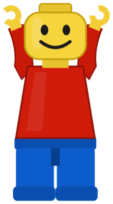

**Klemmi** ist das Maskottchen des TN Dashboards: eine klassische rote Lego-Figur, die winkt, zeigt, blinzelt, beim Sprechen den Mund bewegt und am Ende jubelt. In `TN-Dashboard-Tutorial.html` erklärt er die App. Gleich am Anfang, an der Stelle der Anmeldung, fragt er **„Wer bist du?“**: links **Lehrer**, rechts **Schüler**. Danach geht es mit dem passenden Tutorial weiter.

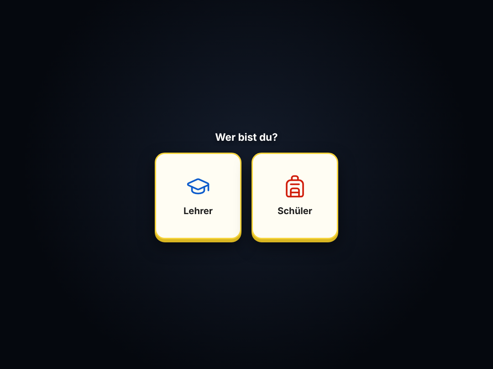

| Schüler-Tutorial | Lehrer-Tutorial |
|---|---|
| Wie man die App bedient. **Jeder Bereich wird mindestens einmal geöffnet:** Suche, Minifig-Finder, Pickliste, Inventar mit Lagerplan, Lagerort, Inventur, Teile-Scanner mit Teile-Seite, Umlagern mit dem Knopf „Zu BrickLink übertragen“, Auftragszentrale, Analyse und „Meine Aktivitäten“. | Alles, was nur Lehrer dürfen, **ausführlich:** Lehrer-Ansicht mit Protokoll und CSV, Schüler anlegen und löschen, Dev-Rolle vergeben, Lager aus BrickLink übernehmen, „Aktivität pro Teilnehmer“ in der Analyse, Dev-Bereich mit allen fünf Reitern (System, Tests, Daten, API, Einstellungen) und die Darstellungs-Einstellungen. Die Listen der Bereiche nur kurz. |

- Man klickt jeden Schritt selbst. Der Hintergrund wird abgedunkelt, nur das Ziel leuchtet, ein hüpfender Pfeil mit „Hier tippen!“ zeigt darauf.
- Klemmi spricht in Sprechblasen, locker und mit ein paar Witzen; oben stehen Kapitel und Tutorial, darunter ein Fortschrittsbalken als Lego-Stein.
- Wer sich verläuft, wird zurück zur Startseite gelotst; „Ich finde es nicht“ hilft, wenn ein Ziel fehlt. Mit dem X kann man jederzeit aufhören und frei weiterprobieren.
- Das Tutorial hat eigene Daten und beginnt bei jedem Öffnen von vorn.


|  | 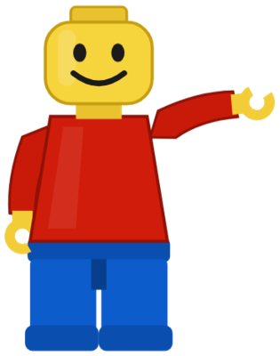 |  |
|:---:|:---:|:---:|
| winkt zur Begrüßung | zeigt, wohin du tippen sollst | jubelt, wenn du fertig bist |

Wer mit einem KI-Agent weiterarbeitet: Projektwissen, Regeln und offene Punkte stehen in [`CLAUDE.md`](CLAUDE.md).
