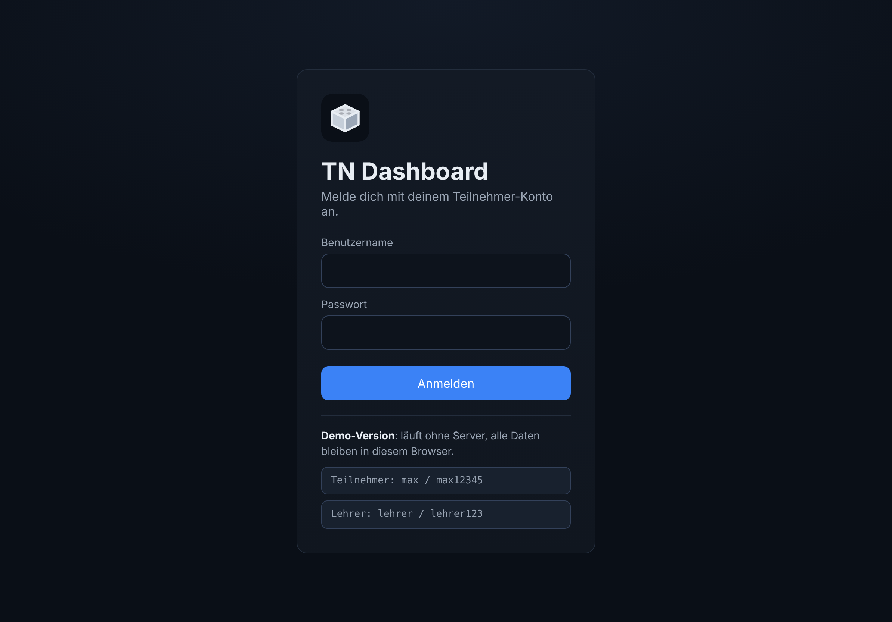

<div align="center">


# TN Dashboard

**Alle Werkzeuge für den Lego-Shop in einer App:**
**Pickliste, Minifig-Finder, Inventar, Umlagern und mehr, für Teilnehmer und Lehrer.**


</div>

## Worum geht es?

Im Lego-Shop arbeiten wir mit BrickLink, BrickStore und dem Brickscanner. Das **TN Dashboard** bringt diese Funktionen für die Teilnehmer an einem Ort zusammen und läuft im Browser auf iPad, PC und Handy.

Jede Aktion wird pro Teilnehmer protokolliert. So kann der Lehrer dokumentieren, wer was gemacht hat.

| Modul | Was es macht | Stand |
|---|---|---|
| Minifig-Finder | Minifiguren und Varianten finden | Platzhalter, Integration des bestehenden Servers geplant |
| Pickliste | Bestellungen kommissionieren, Fehlmengen melden | Platzhalter, Integration geplant |
| Inventar | Bestände, Lagerorte, Bestandsverlauf | Platzhalter, Integration geplant |
| Umlagern | Mischkisten analysieren, Sortiervorschläge | Platzhalter |
| Teile-Scanner | Teile, Barcodes und Lagerplatzcodes scannen | Platzhalter |
| Auftragszentrale | Bestellungen importieren und verfolgen | Platzhalter, Integration geplant |
| Inventur | Mengen prüfen, Abweichungen korrigieren | Platzhalter |
| Analyse | Engpässe und Kennzahlen | Platzhalter |
| Profile und Lehrer-Ansicht | Login, Aktivitätsprotokoll, CSV-Export | fertig |

## Screenshots

<table>
  <tr>
    <td width="50%"><br><sub><b>Login</b>: jeder Teilnehmer hat ein eigenes Konto</sub></td>
    <td width="50%"><br><sub><b>Lehrer-Ansicht</b>: Teilnehmer verwalten und sehen, wer was gemacht hat</sub></td>
  </tr>
</table>

<p align="center">
  <br>
  <sub><b>Auf dem Handy</b>: Das Layout passt sich jeder Bildschirmgröße an</sub>
</p>

## So ist es aufgebaut

- **Frontend:** Vue 3 und Vite als installierbare Web-App (PWA). Der Build erzeugt statische Dateien, auf dem Server ist kein Node nötig.
- **Backend:** PHP 8.1+ ohne Framework, läuft auf jedem normalen Webspace.
- **Datenbank:** die vorhandene MySQL/MariaDB der Schule. Alle Tabellen haben den Präfix `tn_`, damit die App getrennt vom Lehrer-Dashboard bleibt.
- **BrickLink:** API-Antworten werden in der Datenbank zwischengespeichert, um das Tageslimit zu schonen.

```
api/        PHP-API, Installationsseite, BrickLink-Client und Cache
frontend/   Vue-App (Dashboard, Module, Profile, Lehrer-Ansicht)
docs/       Logo und Screenshots
start.sh    lokal starten (Mac/Linux), start.bat für Windows
```

## In der Schule einrichten
1. `cd frontend && npm install && npm run build` erzeugt den Ordner `dist/` mit Frontend und PHP-Backend.
2. Den Inhalt von `dist/` in einen Ordner auf dem Webserver hochladen, z. B. `/tn-dashboard/`.
3. `https://<server>/tn-dashboard/api/install.php` aufrufen.
   - Die Seite sucht die vorhandene **`.env`** des Servers automatisch: im App-Ordner, im Web-Root und eine Ebene darüber. Sie zeigt an, welche Werte gefunden wurden. Angezeigt werden nur die Namen, nie die Werte.
   - Danach legt sie die Tabellen (`tn_…`) und das erste Lehrer-Konto an.
4. Nur falls die `.env` woanders liegt oder die Variablen anders heißen: `api/config.example.php` nach `api/config.php` kopieren und dort `'env_file'` und `'env_map'` anpassen.
   Ohne `.env` können die Werte auch direkt in `api/config.php` eingetragen werden.

Erkannte Variablennamen (Standard): `DB_HOST`, `DB_PORT`, `DB_DATABASE`/`DB_NAME`, `DB_USERNAME`/`DB_USER`, `DB_PASSWORD`/`DB_PASS`, `BRICKLINK_CONSUMER_KEY`, `BRICKLINK_CONSUMER_SECRET`, `BRICKLINK_TOKEN`, `BRICKLINK_TOKEN_SECRET`.

Die `.env` wird nur gelesen und nie verändert. Eine `.htaccess` im App-Ordner sperrt den Zugriff auf versteckte Dateien wie `.env` über das Web.

Voraussetzungen: PHP 8.1+ mit PDO (MySQL) und cURL, MySQL/MariaDB.

## Lokal testen
- **Mac/Linux:** `./start.sh`
- **Windows:** `start.bat`

Das Skript prüft PHP und Node und legt eine lokale `.env` mit SQLite an (Daten in `local-data/`). Beim ersten Mal baut es die App und erstellt Test-Konten. Dann startet es die App und öffnet sie im Browser, sobald der Server bereit ist (http://127.0.0.1:8000, bei belegtem Port der nächste freie).

Nach Code-Änderungen baust du mit `./start.sh --neu-bauen` neu. Die Test-Daten bleiben dabei erhalten.

Test-Konten: `lehrer/lehrer123`, `max/max12345`, `erika/erika123`.

### Ohne PHP: Demo-Version
`cd frontend && npm run build:demo` erzeugt `demo-dist/tn-dashboard-demo.html`. Das ist eine einzelne Datei, die ohne Server läuft. Login und Protokoll werden dabei nur im Browser gespeichert. Gedacht ist sie zum Ausprobieren und Vorzeigen.

### Entwicklung mit Hot-Reload
```sh
./start.sh                      # einmal ausführen: legt .env und Test-Daten an (danach Ctrl+C)
php -S 127.0.0.1:8000 -t .      # PHP-API aus dem Projektordner
cd frontend && npm run dev      # Vite mit Proxy auf /api
```
